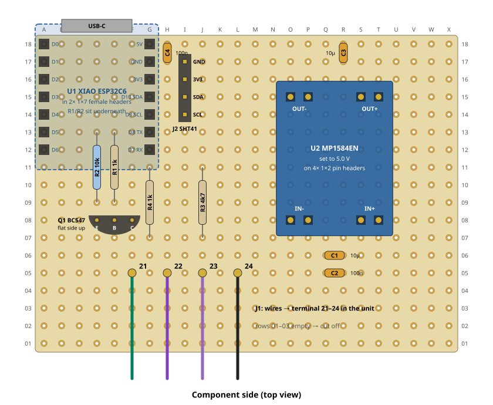
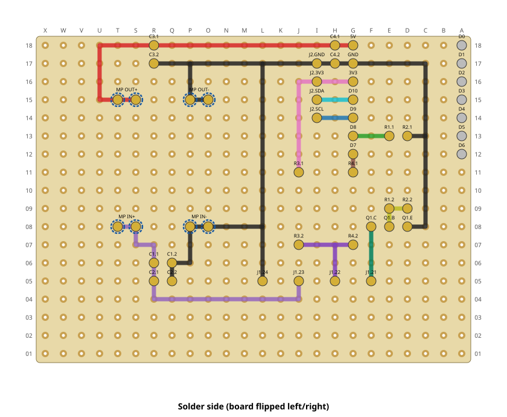

# Perfboard build

The replacement circuit from [docs/hardware.md](../docs/hardware.md) on a 24 × 18 hole
perfboard (2.54 mm, single pads). The solder side uses straight bare wires only, no
crossings. Rows 01–03 stay empty and can be cut off (→ 24 × 15 holes, ~62 × 39 mm).

| Component side | Solder side |
|---|---|
|  |  |

Hole-by-hole wiring and part placement: [wiring.md](wiring.md).
[`perfboard.py`](perfboard.py) generates the drawings and the list and checks every net
against the schematic (`python3 perfboard.py`; the PNGs need `rsvg-convert`).

## Parts

| Ref | Part | Note |
|---|---|---|
| U1 | Seeed XIAO ESP32C6 | in 2 × 1×7 female headers (R1/R2 sit underneath) |
| U2 | MP1584EN buck module | on 4 × 1×2 pin headers; **set to 5.0 V without load first** |
| Q1 | BC547 (NPN) | flat side towards the XIAO; 2N2222 works too — mind the pinout |
| R1, R4 | 1 kΩ | |
| R2 | 10 kΩ | base pull-down |
| R3 | 4.7 kΩ | pull-up on 22 |
| C1, C3 | 10 µF, ≥ 16 V | ceramic, or electrolytic with + on pin 1 (see wiring.md) |
| C2, C4 | 100 nF | |
| J2 | 1×4 pin header | cable to a SHT41 breakout (GND, 3V3, SDA, SCL — check your breakout's order) |
| J1 | 4 stranded wires | to the panel terminal 21–24 in the unit |

The SHT41 breakout brings its own I²C pull-ups; for a bare sensor add 10 kΩ from SDA and
SCL to 3V3 at the sensor end. Keep the sensor away from the board and the unit (cable of
a few decimetres) so it measures the room, not the electronics.

## Notes

- **Never connect USB while terminal 23 is powered**: the MP1584 feeds the XIAO 5V pin
  directly, without a diode. Flash the XIAO out of its sockets or via OTA.
- Check before plugging in the XIAO: 5.0 V between G18 (5V) and G17 (GND) with 23/24
  connected, and no short between 21/22 and 23.
- Never connect terminal 23 (9.7 V) to any XIAO pin.
